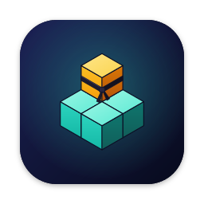
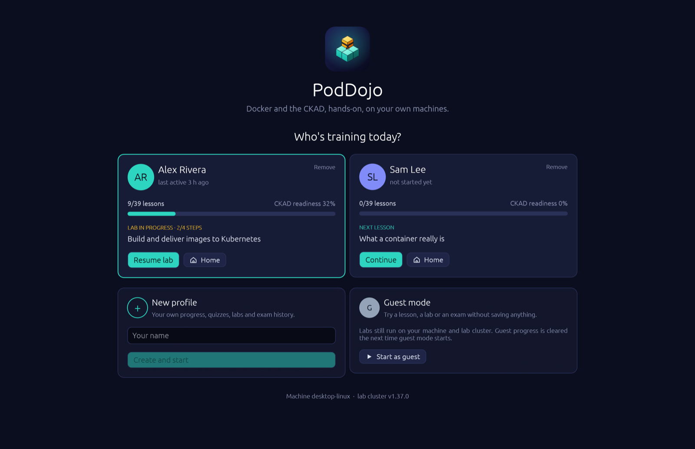
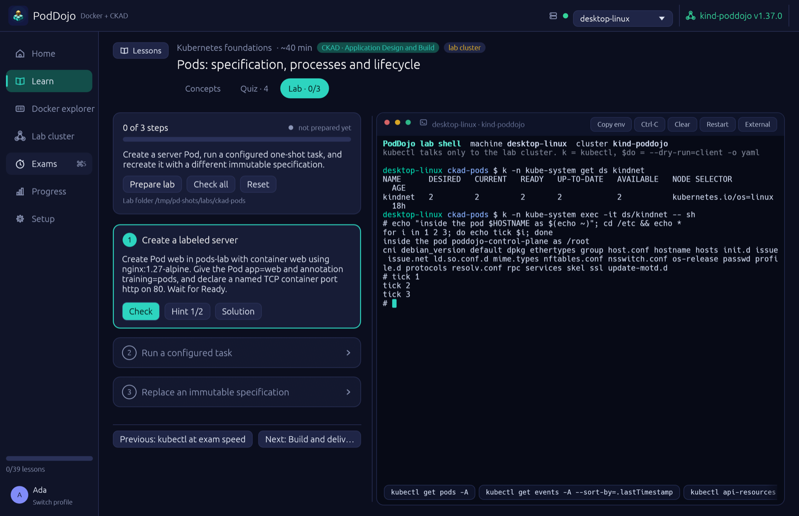
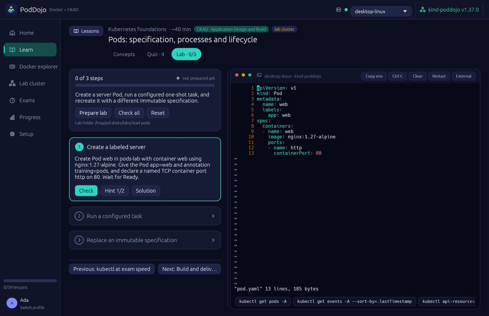
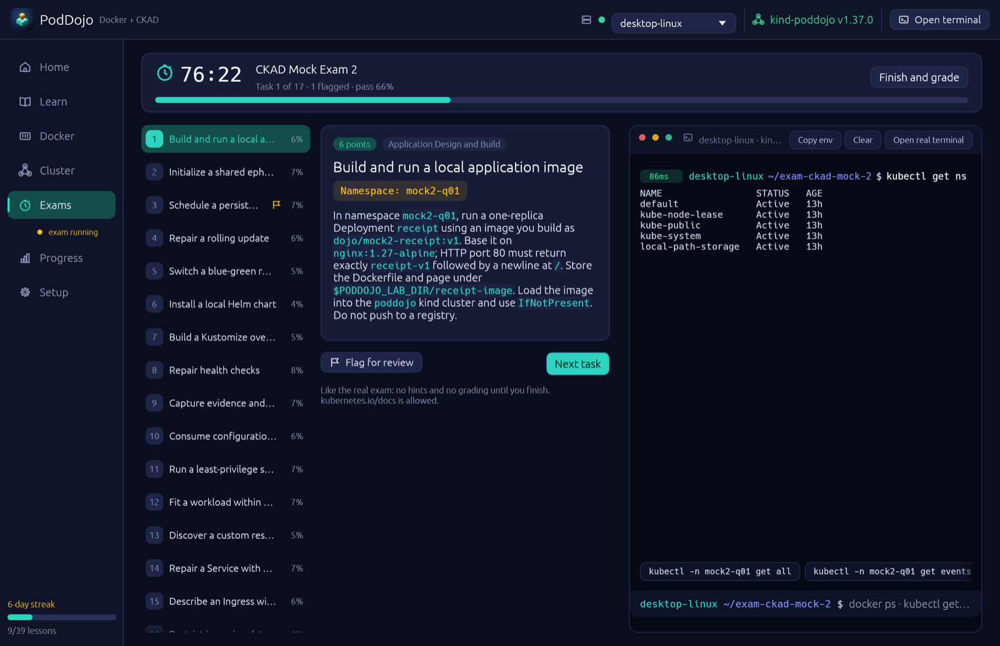
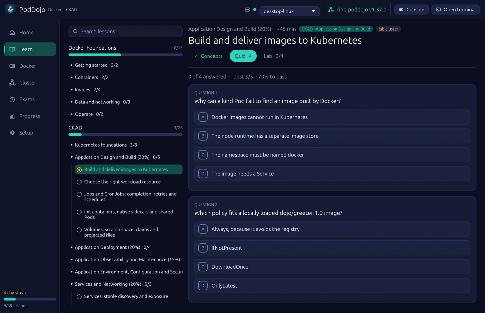

<p align="center">
  
</p>

<h1 align="center">PodDojo</h1>

<p align="center">
  <b>A hands-on dojo for Docker and the CKAD, on your own machines.</b><br>
  Learn the concepts, do real labs that grade themselves, take timed mock exams,<br>
  and always pick up exactly where you left off. Ultralight, native, pure Rust.
</p>

<p align="center">
  
  
  
  
</p>

<p align="center">
  
</p>

<p align="center">
  
</p>

<table>
  <tr>
    <td width="25%" valign="top">
      <h3>🖧 Your machines</h3>
      Pick where Docker runs: Docker Desktop on this Mac or any Linux box over SSH. Every Docker context is a machine you can train on.
    </td>
    <td width="25%" valign="top">
      <h3>🧪 Labs that grade themselves</h3>
      159 lab steps across 40 lessons. Press <b>Check</b> and PodDojo inspects the real containers and Kubernetes objects you created.
    </td>
    <td width="25%" valign="top">
      <h3>⏱ Real exam practice</h3>
      Four timed, performance-based CKAD mock exams (68 tasks) with partial credit, a score per domain, and missed tasks coming back as timed drills.
    </td>
    <td width="25%" valign="top">
      <h3>⚡ Ultralight</h3>
      A native egui window (no Electron, no web view) that drives <code>docker</code>, <code>kubectl</code>, <code>kind</code> and <code>helm</code> exactly like you will in the exam.
    </td>
  </tr>
</table>

## The curriculum

| Track | What you learn | Lessons |
|---|---|---|
| **Docker Foundations** | the terminal, YAML and vim from zero, containers as processes, the engine and contexts, run/inspect/debug, images and layers, Dockerfiles, multi-stage builds, registries and digests, volumes, networks, Compose, limits and hardening | 14 |
| **CKAD** (curriculum v1.37) | the lab cluster and kubectl at exam speed, Pods, workloads, Jobs/CronJobs, multi-container Pods, volumes, rolling updates, blue/green and canary, Helm, Kustomize, probes, logs, debugging, API deprecations, ConfigMaps, Secrets, resources and quotas, ServiceAccounts and RBAC, SecurityContexts, CRDs and Operators, Services, Ingress, NetworkPolicies, exam strategy | 26 |
| **Mock exams** | 16–18 tasks each, 2 hours, 66% to pass, weighted 20/20/15/25/20 like the real exam; mock 4 is exam-day hard | 4 |
| **Reference** | kubectl at speed, annotated Pod YAML, workloads, config and secrets, networking, observability, packaging, API deprecations: the in-app counterpart of the docs allowed in the exam (⌘K opens it beside your work) | 8 pages |

Every lesson has **Concepts** (with ▶ Run buttons on every shell snippet), a **Quiz** that explains
each answer, and a **Lab** with hints and worked solutions. A lesson is complete when you have read
it, passed the quiz (70%) and passed every lab step.

**Review** brings back what you miss: every quiz answer and mock-exam task joins a spaced-repetition
deck (1, 3, 7, 16, 35 days; misses return the same day), and tasks you did not solve in a mock come
back as timed drills, set up fresh on the cluster. **Would you pass today?** is an honest verdict
built from your fresh first attempts of each mock (retakes measure memory, so they do not count),
curriculum coverage and weak domains, and it says what to do next.

<p align="center">
  
  <br><sub><b>The workspace</b>: steps on the left, a real interactive terminal on the right; drag the divider to resize</sub>
</p>

<table>
<tr>
<td width="50%" valign="top"><p align="center"><sub><b>kubectl exec -it</b>: an interactive shell in a Pod</sub></p></td>
<td width="50%" valign="top"><p align="center"><sub><b>vim</b>: edit manifests like in the exam</sub></p></td>
</tr>
<tr>
<td width="50%" valign="top"><p align="center"><sub><b>Mock exam</b>: timer, flags, the task and your terminal</sub></p></td>
<td width="50%" valign="top"><p align="center"><sub><b>Exams</b>: best score, domain weights, review past attempts</sub></p></td>
</tr>
<tr>
<td width="50%" valign="top"><p align="center"><sub><b>Concepts</b>: Markdown with runnable snippets</sub></p></td>
<td width="50%" valign="top"><p align="center"><sub><b>Quiz</b>: every answer explained</sub></p></td>
</tr>
</table>

<sub>Screenshots use sample progress.</sub>

## Get started

You need Docker (Docker Desktop, or Docker Engine on Linux), `kubectl` and `kind`; `helm` for the
Helm lessons. On macOS:

```bash
brew install kubectl kind helm
```

Then build and run (Rust 1.99, pinned in `rust-toolchain.toml`):

```bash
cargo run -p poddojo --release
```

Or install it as a regular macOS app (Dock, Spotlight, its own icon):

```bash
cargo xtask bundle --install
```

Shortcuts: <kbd>⌘1</kbd>–<kbd>⌘9</kbd> pages, <kbd>⌘K</kbd> reference window, <kbd>⌘J</kbd> terminal, <kbd>⌘T</kbd> a real terminal window with the lab environment.

1. **Who's training?** Pick your profile (or create one) on the welcome screen, or try things in
   **guest mode** without saving. Each profile keeps its own progress, quiz scores, exam history and
   lab sessions: a lab you leave half-done resumes with its hints and last checks.
2. **Pick a machine** in the top bar. To add a Linux server once:
   `docker context create my-server --docker host=ssh://user@192.168.1.20`
3. Start with **Docker Foundations**, or jump to the CKAD track.
4. For the CKAD track, create the **lab cluster** (Cluster page, about a minute).
5. Work in the built-in terminal: a real shell (`vim`, `watch` and `kubectl exec -it` work) that
   already points at your machine and lab cluster. **External** opens your own terminal app the
   same way.

### Safety

Your machines and clusters are real, so PodDojo is careful:

- It only ever talks to Kubernetes through **its own kubeconfig** (context `kind-poddojo`) and refuses
  anything else. Your `~/.kube/config` and your other clusters are never read or touched.
- Labs name everything `dojo-…` and use their own namespaces. Lesson commands are validated: no
  prune, no "all containers", no `sudo`, no context switching.
- Removing a container you did not create through PodDojo asks first.

## The `dojo` CLI

The same progress, from any terminal (or for an AI tutor such as Claude Code or Codex):

```bash
dojo profiles          # who is studying (same profiles as the app)
dojo status            # completion, CKAD readiness by domain, where to continue
dojo next              # the lesson to continue with
dojo prepare <lesson>  # set the lab up
eval "$(dojo env <lesson>)"   # point this shell at your machine and the lab cluster
dojo check <lesson>    # grade the lab
dojo exam start ckad-mock-1   # start the clock; dojo exam grade when done
dojo status --json     # machine-readable, for agents
```

Run `cargo run -q -p dojo -- help` for everything.

## Under the hood

Pure Rust in a small workspace: `core` (curriculum, progress, grading), `runner` (machines, commands,
lab cluster), `ui` (egui), `apps/poddojo` and `apps/dojo`. See [docs/architecture.md](docs/architecture.md)
and, to write lessons, [docs/content-authoring.md](docs/content-authoring.md). Every lab and exam is
verified end to end on a real cluster with `dojo verify`.

```bash
cargo xtask ci     # fmt, clippy -D warnings, tests, content validation
```

## License

Code and original assets: MIT OR Apache-2.0. Docker, Kubernetes and CKAD are trademarks of their
owners; PodDojo is an independent study tool, not affiliated with Docker, Inc., the CNCF or the Linux
Foundation. The exam format changes: always check the official CKAD page and candidate handbook.
